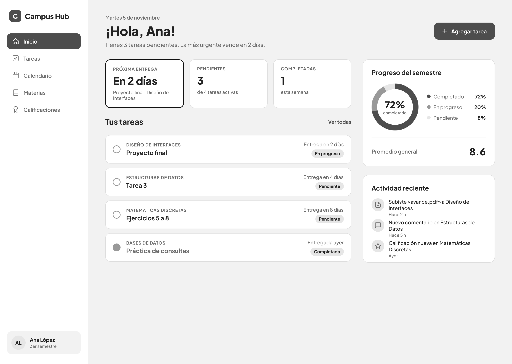
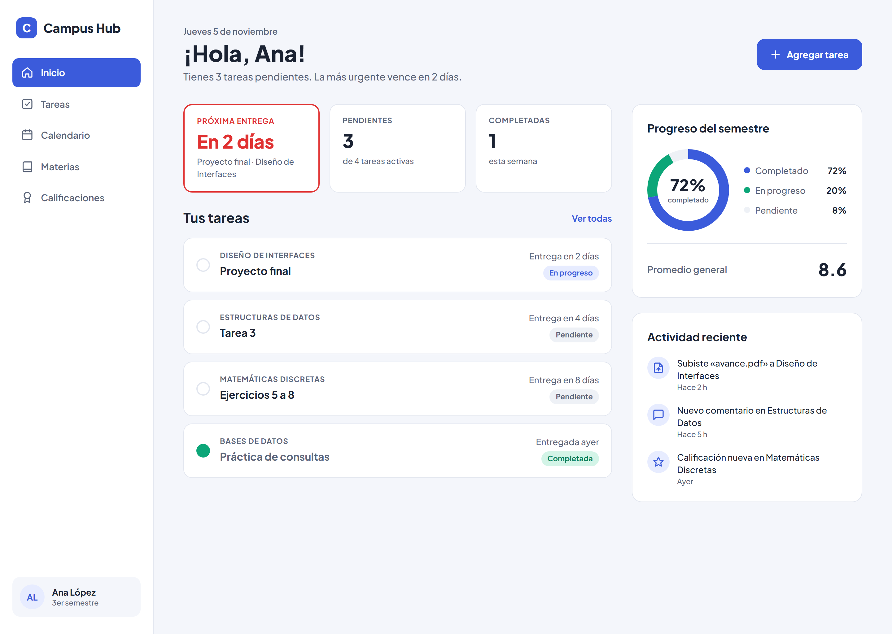
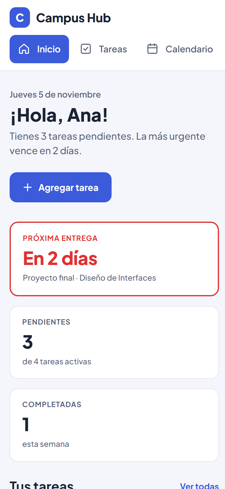
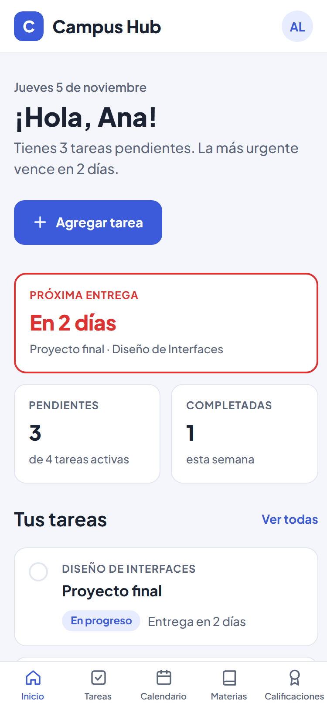
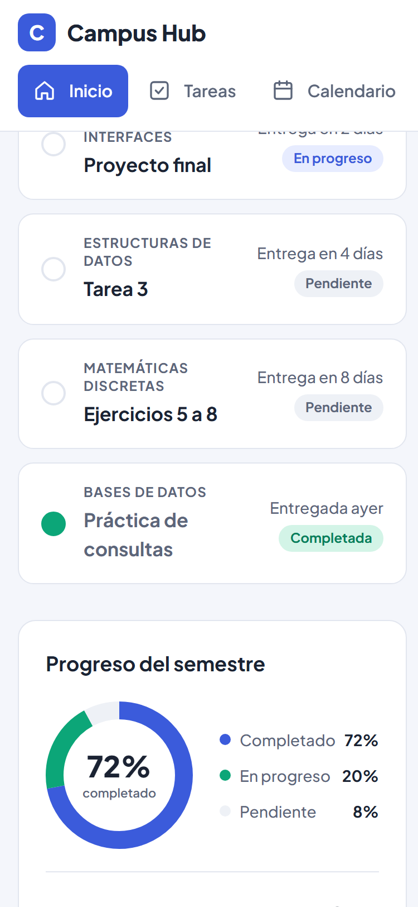
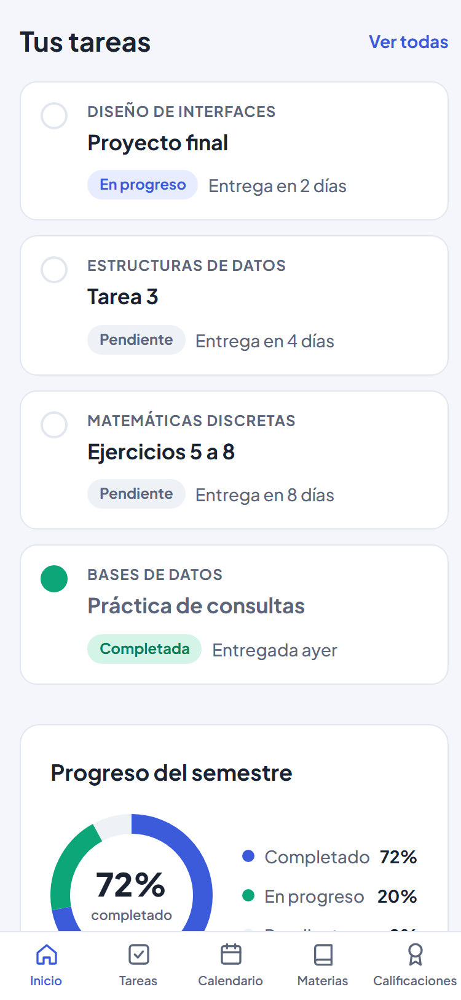
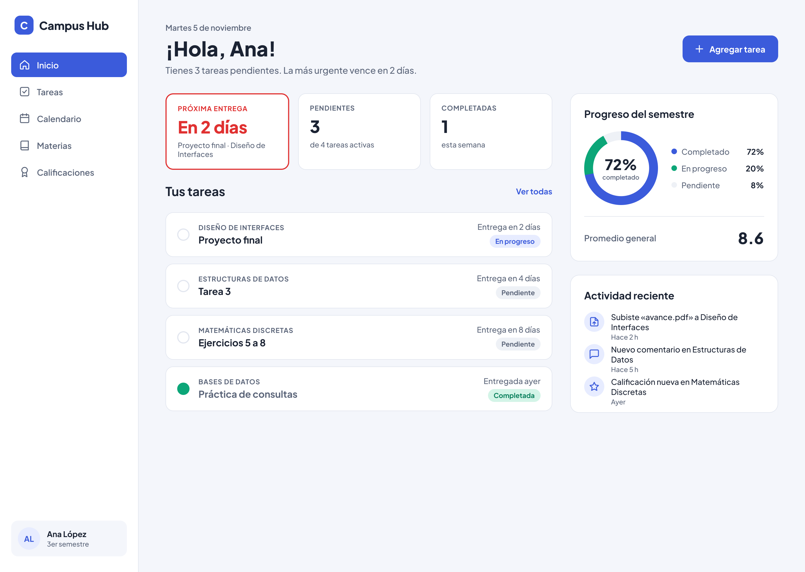

# Entrega: Misión Campus Hub

## 1. Archivo de Figma

Enlace (equipo UMM-DI-2026): https://www.figma.com/design/MLtAymzDRXPkzoqJ8g399Y

| Página | Contenido |
| --- | --- |
| 1 · Wireframe | Wireframe en grises de 1440 × 1024 con Auto Layout y los componentes (íconos, navegación, tarjeta de tarea, tarjeta de dato, actividad). |
| 2 · Color | Versión con mala armonía y su análisis, y la versión final con la paleta guardada como estilos «Campus Hub/…». |
| 3 · Gestalt | Versión final con los cinco principios señalados (marcadores 1 a 5) y una nota por cada uno. |

Wireframe en escala de grises, exportado en PNG a 2x: 

### Prueba de los 5 segundos

Le mostré el wireframe en grises a un compañero durante 5 segundos y le pregunté qué vio primero.

> «Lo primero que notas al ver la app es que se ve súper ordenado y limpio, casi como si fuera un
> plano. Las letras grandotas y los botones oscuros resaltan bastante y te guían rapidísimo para
> saber en qué fijarte sin confundirte. Además, está muy curioso cómo del lado derecho pusieron un
> muestrario con todas las piececitas sueltas que usaron para armar la pantalla principal.»

**Resultado:** la jerarquía general se entiende. Lo que más resalta son los títulos grandes
(el saludo) y los elementos oscuros (el botón «Agregar tarea» y la navegación activa), y la
pantalla no se siente confusa. El «muestrario» que menciona es el marco de componentes que está
junto al wireframe en Figma. No mencionó la tarjeta de «Próxima entrega», que es lo más
importante para Ana: en grises solo se distingue por su borde más grueso. Por eso, en la
versión a color, esa tarjeta es el único lugar donde se usa el rojo (Alerta), para que sea lo
primero que se vea.

## 2. Paleta

| Color | HEX | Función |
| --- | --- | --- |
| Primario | `#3B5BDB` | Botón «Agregar tarea», navegación activa, progreso completado, enlaces |
| Secundario | `#0CA678` | Progreso «en progreso», tareas completadas |
| Alerta | `#E03131` | Entrega más próxima o urgente (solo ahí, para que destaque) |
| Fondo | `#F4F6FB` | Fondo general de la página |
| Superficie | `#FFFFFF` | Tarjetas, barra lateral, texto sobre el primario |
| Texto | `#1B2333` | Títulos y texto principal (≈ 14.5:1 sobre Fondo) |
| Texto secundario | `#5C667A` | Fechas, materias, descripciones (≈ 5.5:1) |
| Borde | `#E2E6EF` | Contorno de tarjetas y divisores |
| Tinte primario | `#E7ECFF` | Chip «En progreso», fondo de íconos y avatar |
| Tinte secundario | `#D3F4E7` | Chip «Completada» |
| Tinte neutro | `#EEF1F6` | Chip «Pendiente», parte pendiente del anillo |

Armonía: el azul y el verde azulado son **análogos**, y el rojo es un acento cálido opuesto
al azul que se reserva para lo urgente. El texto blanco sobre el primario tiene ≈ 5.6:1 de contraste,
así que cumple WCAG AA.

**En 20 segundos:** «Usé azul como primario para todo lo que se puede tocar y el estado activo;
verde, que es análogo, para el progreso y lo completado; y rojo solo para la entrega más
urgente, para que sea lo primero que ves. Los fondos son neutros fríos y el texto tiene
contraste AA.»

## 3. Principios Gestalt

1. **Proximidad:** materia y título están a 4 px, las tarjetas a 12 px y las secciones a 24–32 px; se entiende qué dato pertenece a qué tarea.
2. **Semejanza:** las tarjetas de dato y las de tarea son instancias de un mismo componente; el mismo estado usa el mismo chip.
3. **Figura-fondo:** las tarjetas blancas resaltan sobre el fondo gris azulado; el botón primario y la tarjeta urgente son las figuras con más peso visual.
4. **Continuidad:** saludo, tarjetas de dato, «Tus tareas» y la lista comparten el borde izquierdo; las fechas y los chips se alinean a la derecha.
5. **Cierre:** el anillo de progreso son tres arcos, pero se percibe como un círculo completo («72 % de un todo»).

## 4. Código fuente

Repositorio en GitHub: https://github.com/SangonapouSchool/campus-hub-next

Carpeta `campus-hub/` (Next.js 15, React 19, TypeScript y Tailwind CSS 4). Para ejecutarlo:
`npm install` y luego `npm run dev`. `npm run lint` y `npm run build` pasan sin errores.

## 5. Comparación entre Figma y la app

| # | Diferencia | Categoría | ¿Corregida? |
| --- | --- | --- | --- |
| 1 | A 375 px, las tres tarjetas de dato se apilaban y ocupaban toda la primera pantalla; «Tus tareas», lo más importante, empezaba a ~805 px. | Agrupación y jerarquía / móvil | Sí |
| 2 | A 375 px, la navegación era una fila fija con scroll horizontal: se veía una barra de scroll gris, «Materias» y «Calificaciones» quedaban cortadas y la barra ocupaba ~118 px de alto. | Comportamiento en móvil | Sí |
| 3 | A 375 px, en las tarjetas de tarea la materia se parte en dos líneas porque la columna de fecha y chip le quita ancho. | Tamaños de texto y espaciado en móvil | Sí |

**Corrección 1, jerarquía (proximidad y figura-fondo):** en móvil, la «Próxima entrega» ocupa
todo el ancho y «Pendientes» y «Completadas» van lado a lado (cuadrícula de 2 columnas).
Cómo lo comprobé: la sección «Tus tareas» empezaba a ~805 px y ahora empieza a 576 px, dentro de la primera
pantalla de 812 px.

**Corrección 2, navegación (continuidad y semejanza con apps móviles):** en móvil, la
navegación pasa a una barra inferior de 5 pestañas (ícono y etiqueta) y arriba queda un
encabezado compacto con el logo y el avatar. Cómo lo comprobé: el ancho del documento es de 375 px
(sin scroll horizontal) y ninguna etiqueta se desborda. Volví a probar «Agregar tarea» a 375 px
y la tarea se agregó y la lista se reordenó.

**Corrección 3, tarjeta de tarea (proximidad y jerarquía):** en móvil, el chip de estado y la
fecha bajan a una fila debajo del título, así la materia y el título usan todo el ancho de la
tarjeta. Desde 640 px vuelven a la derecha, como en Figma. Cómo lo comprobé: a 375 px las cuatro
materias caben en una línea («MATEMÁTICAS DISCRETAS» antes ocupaba dos). En escritorio la
tarjeta se ve igual que antes.

En escritorio (1440 px) la app coincide con el marco de Figma. Las únicas diferencias son
intencionales: la fecha es la real y el formulario de «Agregar tarea» aparece al pulsar el botón.

### Capturas

| | Antes | Después |
| --- | --- | --- |
| Escritorio (1440 px) |  |  |
| Móvil, inicio (375 px) |  |  |
| Móvil, lista de tareas (375 px) |  |  |

Las capturas están a 2x, tomadas de la versión de producción (`npm run build` y `npm start`).

Referencia de Figma, exportada en PNG a 2x: 

## 6. Reflexión (borrador: reescríbela con tus palabras)

1. La IA convirtió bien el diseño en componentes reutilizables y en variables con los mismos nombres que los estilos de Figma.
2. Respetó la distribución, los colores y la jerarquía de escritorio casi exactamente.
3. Tuve que corregir la fuente: Next no pudo descargar Google Fonts y la app usaba otra tipografía sin avisar.
4. La primera versión móvil «funcionaba», pero apilaba las tarjetas y escondía las tareas; corregí la jerarquía, la navegación y las tarjetas de tarea.
5. Lo que más pesó en el resultado fue el diseño inicial y la revisión, no el prompt: sin comparar con Figma no habría visto los errores.
